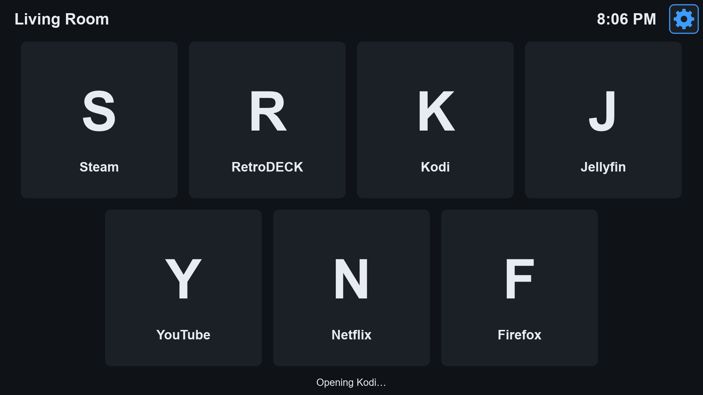
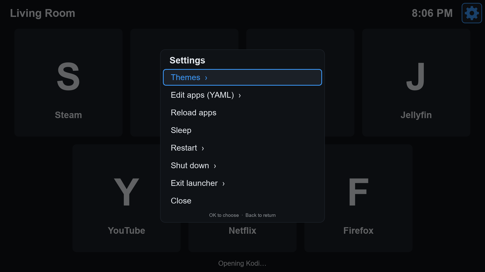
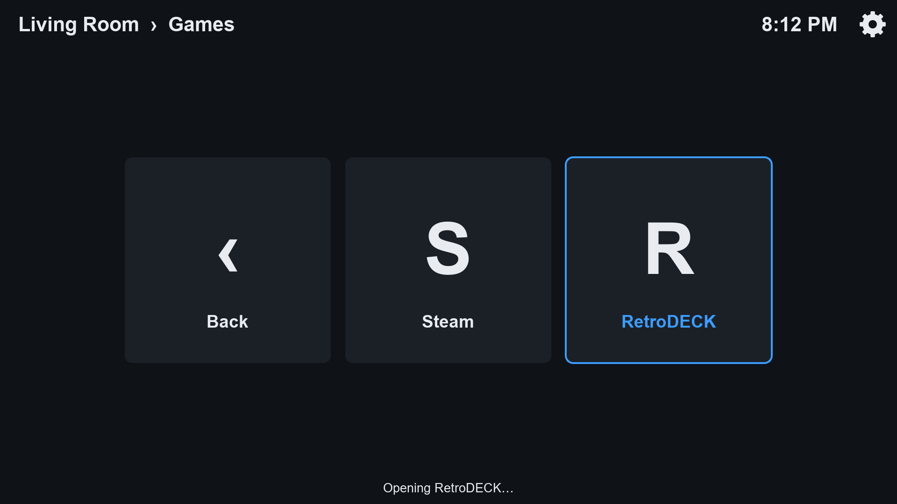

# TV App

A fullscreen app launcher for a TV box (built for Bazzite / Fedora KDE), driven by an air remote.
Apps are listed in a YAML file and laid out automatically to fit the screen.



## Install (on the TV box)

```bash
git clone https://github.com/braywilliam01/TV_App.git
cd TV_App
chmod +x install.sh
./install.sh --autostart
```

`--autostart` opens the launcher when KDE logs in. Leave it off to start it from the app menu ("TV Launcher").
Nothing needs root; everything installs into your home folder.

**Update later:** `cd TV_App && git pull && ./install.sh` (your apps list is never overwritten).

## Controls

| Remote / keyboard | Action |
|---|---|
| D-pad / arrow keys | Move between tiles |
| OK / Enter | Open app |
| Up from the top row, or Menu key | Settings (gear, top right) |
| Back / Esc | Close menus (does nothing on the home screen) |
| Home | Jump to first tile |
| Ctrl+Q | Quit |

Pointing and clicking with the air mouse works too. After using the D-pad the pointer hides, so air-mouse wobble
doesn't move the selection.

## Settings menu

- **Themes:** Midnight, Ocean, Forest, Sunset, Light, High Contrast
- **Edit apps:** built-in YAML editor that checks the file as you type and won't save a broken file
- **Reload apps, Sleep, Restart, Shut down, Exit** (with confirmation, Cancel selected by default)



## Adding apps

Edit `~/.config/tv-launcher/apps.yaml` (or use Settings > Edit apps on the TV):

```yaml
apps:
  - name: Kodi
    command: flatpak run tv.kodi.Kodi
    icon: tv.kodi.Kodi            # installed app icon name, or an image like icons/kodi.png

  - name: YouTube
    url: https://www.youtube.com  # opens in the browser from settings.browser
    icon: icons/youtube.png
```

### Minimize to desktop

The default list includes a **Desktop** tile that hides the launcher and shows the KDE desktop:

```yaml
  - name: Desktop
    action: minimize
    icon: user-desktop
```

To get back, open **TV Launcher** from the app menu or taskbar. It brings the running launcher back
(fullscreen) instead of starting a second copy.

### Icons (optional)

`icon:` can be left out (the tile shows the first letter), or be any of:

| Kind | Example |
|---|---|
| Local image (relative to `apps.yaml`, or a full path) | `icon: icons/netflix.png` |
| Web image | `icon: https://example.com/netflix.png` |
| Installed app's icon name | `icon: tv.kodi.Kodi` |

Put local images in `~/.config/tv-launcher/icons/`. Web images download in the background and are kept in
`~/.cache/tv-launcher/icons/`, so they work offline afterwards. Delete that folder to fetch fresh copies.
A broken link or a non-image just shows the letter and a warning; Settings > Reload apps retries it.

### Screensaver (optional)

After a set number of idle minutes on the home screen, the launcher can fade into a fullscreen slideshow.
Any key, click, or pointer move brings the launcher back.

```yaml
settings:
  screensaver_minutes: 10          # idle minutes before it starts; 0 (default) turns it off
  screensaver_interval: 8          # seconds each image is shown
  screensaver_source: bundled      # "bundled" (a free rotating photo set) or "folder"
  screensaver_folder: "~/Pictures" # used when screensaver_source is "folder"
```

`bundled` needs no setup and downloads a rotating set of free stock photos in the background (cached for
offline use afterwards, same as web icons). `folder` shows your own images instead — point it at any folder
and it rotates through everything inside (png/jpg/jpeg/webp/gif/bmp/ico, plus iPhone-style HEIC/HEIF photos).

The screensaver only kicks in while the launcher itself is the active window, so it won't interrupt
whatever you're actually watching or playing in another app.

### Groups (secondary screens)

Give an entry its own `apps:` list instead of a `command:` and it becomes a group tile. Opening it shows a second
screen with those apps. Return with the remote's Back button or the **‹ Back** tile. Groups can contain groups.

```yaml
apps:
  - name: Games
    icon: icons/games.png
    apps:
      - name: Steam
        command: steam steam://open/bigpicture
      - name: Arcade            # a group inside a group
        apps:
          - name: RetroDECK
            command: flatpak run net.retrodeck.retrodeck
```


